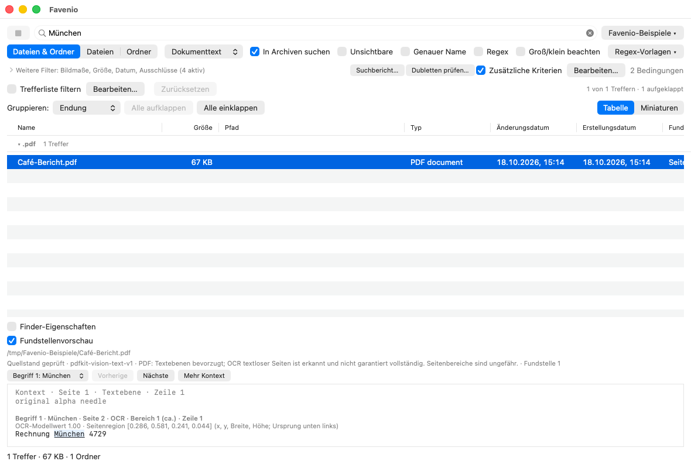
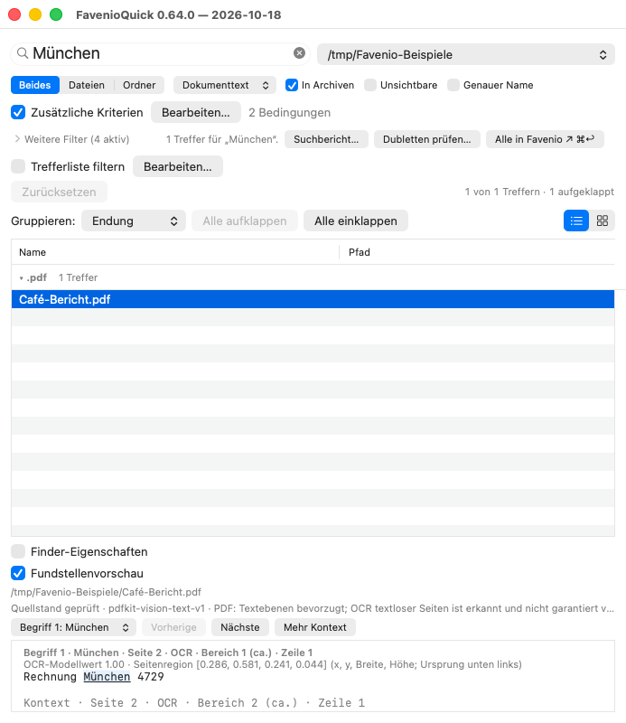

**🌐 Sprache / Language:** [English](README.md) · [Deutsch](README.de.md)

# Favenio

**„facile invenio", Latein für „ich finde mit Leichtigkeit".**

Favenio ist eine indexlose Dateisuche für macOS im Stil von EasyFind: Sie
durchsucht das Dateisystem direkt (ohne Index, ohne Spotlight) nach Dateinamen
oder Dateiinhalten. Die Besonderheit: **Favenio schaut auch in Archive
hinein.** Unterstützt werden die Zip-Familie (zip, jar, whl, epub, docx, xlsx,
pptx, odt, ods, odp, pages, numbers, key), die Tar-Familie (tar, tar.gz/tgz, tar.bz2/tbz2,
tar.xz/txz) und einzeln komprimierte Dateien (gz, bz2, xz — `notiz.txt.gz`
enthält also `notiz.txt`), auf Wunsch auch Archive in Archiven.

Zwei optionale Integrationen erweitern die Liste: Mit dem System-`bsdtar`
(in macOS enthalten) liest Favenio auch **7z** und **ISO**-Abbilder, und wenn
ein `zstd`-Programm installiert ist (z. B. über Homebrew, wird automatisch
gefunden) zusätzlich **zst** und **tar.zst**. Ohne diese Werkzeuge bleiben
die Dateien einfach normale Dateien — wie bisher.

Der Suchkern ist pures Python 3 (nur Standardbibliothek), eine Datei, keine
Installation. Darauf aufbauend gibt es zwei native macOS-Apps: ein großes
Suchfenster und ein kleines Schnellsuche-Panel für die Finder-Toolbar.

## Neu in 0.64.0

Seit dem letzten GitHub-Release 0.38.5 sind in beiden Apps hinzugekommen:

- Ein grafischer Editor für verschachtelte UND-/ODER-Kriterien, mehrere
  Suchdateien und -ordner, Kalenderbereiche, Finder-Tags und Finder-Kommentare.
- Kanonischer Unicode-Vergleich und wählbare Textkodierungen mit
  quellengebundener Vorschau, Fundstellennavigation und Kontext auf Anforderung.
- Logische Textsuche in PDF, DOCX, ODT, EPUB, XLSX und PPTX. Lokale Bild-OCR und
  OCR textloser PDF-Seiten sind getrennt zuschaltbar; erkannter Text bleibt
  unsicher, eingebettete Office-Bilder sind ausgeschlossen.
- Reversible Trefferfilter, einklappbare Gruppen, Miniaturansichten und
  ausdrückliche Aktionen für das Quellarchiv eines Archivtreffers.
- Eine Option für lokal vorhandene Inhalte mit belegter Unterstützung für
  iCloud Drive auf APFS. Weitere Cloudprovider sind ungeprüft; eine allgemeine
  Offlinegarantie gibt es nicht.
- Ausdrückliche Dublettenprüfung über Dateien und Archivmitglieder mit
  vollständigem Bytevergleich sowie Suchberichte zu Auslassungen und Grenzen.
  Die Prüfung löscht keine Dateien, verändert keine Archive und behauptet keine Speicherersparnis.

Bestehende Vorlagen und Aufzeichnungen bleiben lesbar; neue Fähigkeiten tragen
ausdrückliche Formatversionen und weisen ältere Empfänger ab. Details stehen
in den folgenden Abschnitten und im [Changelog](CHANGELOG.md).

## Screenshots

Die Haupt-App verbindet Kriterien, Dokumenttext und ausdrücklich gewählte lokale OCR.
Das Beispiel zeigt ein gescanntes PDF mit Seitenbeleg und begrenztem Kontext.



Die Finder-Schnellsuche verwendet denselben Suchkern und dieselben Filter.



## Voraussetzungen

- **CLI (`favenio.py`)**: Python 3.9 oder neuer, keine Zusatzpakete.
- **Apps (`Favenio.app`, `FavenioQuick.app`)**: macOS 12 (Monterey) oder
  neuer, Apple Silicon. Die Apps starten den Suchkern mit dem System-Python
  `/usr/bin/python3` aus Apples Command Line Tools; fehlen diese, bietet
  macOS die Installation automatisch an.
- **Schutz lokal vorhandener Inhalte und OCR**: macOS 13 oder neuer; die
  übrigen Suchmodi bleiben unter macOS 12 verfügbar.

## Installation

`Favenio-<version>.dmg` von der
[Releases-Seite](../../releases/latest) laden, öffnen und beide Apps nach
`Programme` ziehen.

Das DMG ist mit einer Developer-ID signiert und von Apple notarisiert;
Gatekeeper öffnet die Apps ohne zusätzliche Schritte.

Ab Version 0.14.0 suchen beide Apps automatisch nach signierten Updates und
installieren sie nur nach Bestätigung. In der Haupt-App gibt es zusätzlich
**Favenio → Nach Updates suchen …**. Bei der Update-Prüfung werden keine
Hardware- oder Systemprofildaten übertragen. Ältere Versionen enthalten noch
keinen Updater; 0.14.0 muss deshalb einmalig über das DMG installiert werden.

Alternativ selbst bauen — drei Skripte, jedes für sich vollständig:

```bash
./build.sh          # beide Apps im Repository bauen und selbst testen (Wrapper auf build-app.sh; ohne Argumente, Einstellungen über Umgebungsvariablen wie `FAVENIO_SIGN_ID`)
./install.sh        # bauen, notarisieren, nach /Applications installieren
./release.sh        # bauen, notarisieren, DMG bauen und notarisieren
```

Quell-Builds können nur ad hoc signiert sein und werden nie automatisch
installiert. Für Tests, die schon vor dem ersten App-Start eine Notarisierung
verlangen, dient `FAVENIO_DEFER_SELFTEST=1 ./install.sh`. Damit werden die
App-Selbsttests des Builds aufgeschoben. Nach der Installation beide
installierten App-Binaries mit `--selftest` starten und prüfen, dass die
letzte Ausgabezeile mit `SELFTEST OK` beginnt.
Was in `/Applications` landet, trägt ein angeheftetes
Notary-Ticket: `install.sh` notarisiert die Bundles selbst, prüft sie vor und
nach dem Kopieren (`codesign`, `spctl`, `stapler validate`) und endet mit Exit-Code 2, wenn der alte Installationsstand unverändert oder
wiederhergestellt ist. Exit 3 meldet einen unvollständigen Rollback samt
verbleibendem Zustand. Eine gültige Signatur
allein genügt nicht: Geprüft werden auch die Bundle-IDs und die übereinstimmende
Version, damit keine fremde notarisierte App unter demselben Dateinamen an die
Stelle von Favenio treten kann. Beide Apps werden als eine Transaktion
getauscht; scheitert ein Schritt, wird die Wiederherstellung beider alten
Stände versucht.
`./install.sh --dmg <pfad>` installiert stattdessen aus einem fertigen DMG,
`./install.sh --verify-only` baut, notarisiert und prüft ohne Installation.
Mit `--dmg <pfad>` prüft es nur das vorhandene Image und dessen Bundles. Auch die Bundles in
einem DMG brauchen ihr eigenes angeheftetes Ticket, damit sie offline starten;
sehr alte DMGs, die es nur am Image tragen, werden abgelehnt. Beide Skripte
prüfen außerdem, dass die Bundles auf den Produktions-Update-Feed zeigen:
`build-app.sh` nimmt für lokale End-to-End-Tests ein abweichendes
`SPARKLE_FEED_URL` an, eine damit installierte oder ausgelieferte App wird
abgelehnt.

## Schnellstart (CLI)

```bash
# Dateinamen suchen („enthält“, Groß-/Kleinschreibung egal)
./favenio.py rechnung ~/Documents

# Glob-Muster (matcht den ganzen Namen)
./favenio.py "*.sketch" ~/Projekte

# Genauer Dateiname — ohne -e ist „release.sh" ein Teilstring und findet
# auch „test-github-release.sh"
./favenio.py -e release.sh ~/git

# Nur zwei Ordnerebenen tief (wie find -maxdepth): welche Projekte haben
# ein Release-Skript?
./favenio.py -e --max-depth 2 release.sh ~/git

# Im Dateiinhalt suchen, auch innerhalb von Archiven
./favenio.py -c "Kündigungsfrist" ~/Documents

# Regulärer Ausdruck, Groß-/Kleinschreibung beachten
./favenio.py -r -s "rechnung-\d{4}" .

# Archive in Archiven durchsuchen (Tiefe 2)
./favenio.py -c geheim ~/Backups --archive-depth 2

# Archive ignorieren
./favenio.py notiz . --no-archives
```

Treffer in Archiven werden mit `!/` markiert:

```
backup.tar.gz!/sicherung/alt.txt:1
aussen.zip!/innen.zip!/tief/verstecktes.txt
```

Bei Inhaltssuche hängt `:N` die Zeilennummer des ersten Treffers an.

Kommt ein Eintragsname mehrfach in einem ZIP- oder TAR-Archiv vor
(einschließlich gzip/bzip2/xz-komprimierter TARs), verwenden Suche und
Extraktion den letzten Eintrag. Bei über `bsdtar` gelesenen Formaten,
einschließlich TAR.ZST, gilt der erste Eintrag.

## Nutzung durch Skripte und AI-Agenten (headless)

Favenio ist bewusst maschinenfreundlich gebaut:

- **`--json`**: Ein Treffer pro Zeile als JSON-Objekt (JSONL), etwa
  `{"path": "...", "type": "member", "isDirectory": false, "filesystemPath": "/tmp/a.zip", "archiveMembers": ["innen.txt"], "archiveMemberBytes": ["aW5uZW4udHh0"], "line": 2}`.
  `path` bleibt die menschenlesbare Darstellung; Automation sollte die
  eindeutigen strukturierten Felder verwenden. Jeder Treffer trägt `path`,
  `type`, `isDirectory`, `filesystemPath` und `archiveMembers`. Archivtreffer
  tragen außerdem `archiveMemberBytes`: die exakte Base64-Namensidentität
  jeder Stufe. Inhaltstreffer
  zusätzlich `line`. Dateien tragen `size` (entpackte Bytes), **soweit das
  Format die Größe vorab nennt**: normale Dateien, Zip- und Tar-Einträge ja,
  einzeln komprimierte Dateien (`.gz`, `.bz2`, `.xz`) und über `bsdtar`
  gelesene Einträge (7z, ISO, `.tar.zst`) nein — dort steht die Größe erst
  nach vollständigem Entpacken fest, und die Suche endet beim ersten Treffer.
  Das Feld fehlt ebenfalls, wenn sich die Größe einer normalen Datei nicht
  ermitteln lässt (zum Beispiel bei einem toten Symlink). `size` ist also ein
  optionales Feld. Für „ist das ein Ordner?"
  `isDirectory` fragen, nicht `type`: Ein **Ordner innerhalb eines Archivs**
  kommt genau wie eine Datei als `"type": "member"` an. Metadatentreffer
  tragen zusätzlich `field` und `value`; mit Maßfilter tragen Treffer `width`
  und `height` (Pixel). Alle vier sind optional. `modified` und `created`
  sind Änderungs- und Erstellungszeit als Unix-Sekunden (Gleitkomma):
  normale Dateien und Ordner tragen beide (aus derselben `stat`-Abfrage wie
  `size`), Zip- und Tar-Einträge nur `modified` aus dem Archivkatalog,
  `bsdtar`-Einträge und einzeln komprimierte Dateien keines — beide Felder
  sind also optional.
- **Exit-Codes** wie bei grep: `0` = Treffer, `1` = keine Treffer,
  `2` = Fehler (ungültiger Regex, Pfad fehlt, und jeder unerwartete Fehler,
  der den Lauf abgebrochen hat — ein abgebrochener Lauf darf nie wie ein
  leeres Ergebnis aussehen). Ein geschlossener Leser (`| head -1`, auch
  `2>&1 | head -1`) ist kein Fehler: Der Lauf endet still mit 0 bzw. 1 wie
  bei grep.
- **Warnungen** (unlesbare Dateien, kaputte Archive) gehen nach stderr;
  die Suche läuft weiter, und stdout bleibt sauber parsebar.

```bash
./favenio.py --json -c "TODO" src/ | jq -r .path | sort -u
```

Beginnt das Suchmuster mit `-`, steht davor `--`, damit es nicht als Option
gelesen wird: `./favenio.py -- -entwurf ~/Dokumente`.

Seit 0.36.0 bietet Favenio außerdem einen lokalen Bundle-Helfer, der das sichtbare
Hauptfenster konfiguriert, Suchen startet und abbricht, begrenzte Ergebnisseiten
liest und Treffer über ihre Identität auswählt. Der versionierte JSON-Vertrag
steht unter [lokaler Suchsteuerung](docs/LOCAL-CONTROL.md).

Einen einzelnen Treffer auswählen und im Treffermenü oder unter „Ablage“
**In Fastra zeigen** wählen. Fastra ab 1.137.0 übernimmt eine eigene
schreibgeschützte Inhaltskopie mit exakter Archividentität und Quellengeneration.
Inhaltstreffer werden vor dem UTF-16-Sprung erneut geprüft; nicht belegbare
Fundpositionen bleiben ausdrücklich ungebunden. Eine Nichtstandardkodierung
braucht Fastras Decoderfähigkeit und fehlerfreie Textbindung. Die Übergabe ist
auf 256 KiB Blattinhalt begrenzt und im selben Menü abbrechbar.
Auch reine Filtersuchen im Inhaltsmodus lassen sich übergeben; ohne Suchbegriffe
öffnet sich die Kopie am Anfang ohne belegte Fundposition.

Suchaufzeichnungen (0.38.0) können einen begrenzten gespeicherten Trefferstand ohne Suche wieder öffnen oder seine Konfiguration ausdrücklich mit neuer Laufkennung erneut suchen. Historische Dateiinhalte werden dabei nicht gespeichert. Siehe [Aufnahmebefehle](docs/LOCAL-CONTROL.md#suchaufzeichnungen-ab-0380).
Filteränderungen behalten den Aufnahmehinweis, bis eine neue Suche oder eine
andere Trefferliste den Stand ersetzt. Beim Laden einer Vorlage bleiben auch
die Bestätigung und ein Hinweis auf einen fehlenden Ordner neben der
Aufnahmeherkunft sichtbar.

## Optionen

| Option | Wirkung |
|---|---|
| `--criteria-json JSON` | zusätzlicher versionierter UND-/ODER-Kriterienbaum für Name, Endung, relativen Pfad, Inhalt, Medien-/Finder-Metadaten, Größe, Datum und Bildmaße |
| `--criteria-file DATEI` | denselben Kriterienbaum aus UTF-8-JSON lesen; `-` liest stdin; maximal 64 KiB |
| `--validate-criteria` | nur den angegebenen Kriterienbaum prüfen, ohne Dateisystemsuche |
| `--duplicates-file JSON` | reguläre Dateien und bereitgestellte Archivmitglieder eines Schema-1/2-Auftrags ausdrücklich vergleichen; begrenzter JSONL-Fortschritt und bytegeprüfte Gruppen; [Vertrag](docs/DUPLICATES.md) |
| `--filter-results JSONL` | vorhandene JSONL-Treffer mit dem Kriterienbaum filtern; `-` liest stdin, keine Quellenöffnung |
| `--results-root ORDNER` | rein lexikalische Wurzel für relative Dateipfade im Trefferfilter |
| `--validate-result-filter` | Kriterien ausschließlich für bekannte Trefferwerte prüfen |
| `-c`, `--content` | im Dateiinhalt suchen statt in Namen |
| `--document-text` | logischen PDF-/DOCX-/ODT-/EPUB-/XLSX-/PPTX-Text mit Dokumentbelegen suchen; optionaler PDFKit-Helfer, begrenzt und abbrechbar; siehe [Dokumenttext](docs/DOCUMENT_TEXT.md) |
| `-m`, `--metadata` | in den kuratierten Metadaten-Textfeldern suchen (Stichwörter, Titel, Beschreibung …) statt in Namen; braucht `exiftool` |
| `--metadata-field TAG` | `--metadata` auf ein Feld der kuratierten Liste eingrenzen (wiederholbar; schaltet `--metadata` ein) |
| `--finder-metadata` | Finder-Tags und -Kommentar für passende lokale Objekte erfassen; braucht `--json` |
| `--local-only` | nur lokal vorhandene Inhalte lesen (macOS 13+); Namen/bekannte Fakten bleiben suchbar, ausgelassene Cloudinhalte werden erklärt; siehe [lokale Inhalte](docs/LOCAL_CONTENT.md) |
| `--ocr` | lokale deutsche/englische Bild-OCR im Dokumenttextmodus zuschalten (macOS 13+); [Grenzen und erkannte Belege](docs/OCR.md) |
| `--pdf-ocr` | textlose PDF-Seiten ausdrücklich begrenzt per lokaler OCR lesen; Textebenen bevorzugen, Seitenherkunft erhalten; [Grenzen und Abdeckung](docs/PDF_OCR.md) |
| `--term TEXT` | weiterer Suchbegriff, der ZUSÄTZLICH zutreffen muss (wiederholbar); gleiche Regeln und gleiches Ziel wie das Muster; UND über die ganze Datei, nicht dieselbe Zeile (siehe unten) |
| `--list-metadata-fields` | die kuratierte Feldliste ausgeben, eine je Zeile, und beenden |
| `--min-size BYTES`, `--max-size BYTES` | inklusive Dateigrößengrenzen; ganze nichtnegative Bytezahl, optional B/KiB/MiB/GiB/TiB |
| `--modified-from ISO`, `--modified-to ISO` | inklusive Grenzen der Änderungszeit; ISO-Zeitpunkt mit `Z` oder ausdrücklichem Offset |
| `--created-from ISO`, `--created-to ISO` | inklusive Grenzen der Erstellungszeit; ISO-Zeitpunkt mit `Z` oder ausdrücklichem Offset |
| `--date-ranges-json JSON` | typisierte feste oder relative Kalenderbereiche für Geändert/Erstellt; [Vertrag](docs/DATE_RANGES.md) |
| `--date-reference-time ISO` | ausdrücklicher einmaliger Laufzeitpunkt mit Z/Offset für Kalenderfragen |
| `--date-resolution-json JSON` | vollständig geprüfte konkrete Grenzen für Fortsetzung oder weitere Filterbatches übernehmen |
| `--resolve-date-range JSON` | Kalenderbereich ohne Suche prüfen und konkrete ISO-/Epochgrenzen anzeigen |
| `--min-width PX`, `--max-width PX` | nur Bilder ab / bis zu dieser Breite (Pixel) |
| `--min-height PX`, `--max-height PX` | nur Bilder ab / bis zu dieser Höhe (Pixel); alle vier Maßfilter gelten per UND zusätzlich zum Muster, das dann auch fehlen darf |
| `-r`, `--regex` | Muster als regulären Ausdruck interpretieren |
| `-s`, `--case-sensitive` | Groß-/Kleinschreibung beachten |
| `-e`, `--exact` | Muster muss dem GANZEN Namen entsprechen (mit `-r`: fullmatch; mit `-c` je Zeile) |
| `--literal-wildcards` | Platzhalter wörtlich suchen; Regex und Ausschlüsse bleiben unverändert |
| `--max-depth N` | nur N Ordnerebenen tief suchen (1 = nur direkt im Startpfad, wie `find -maxdepth`) |
| `--no-archives` | nicht in Archive hineinschauen; sie bleiben normale Dateien (siehe unten) |
| `--archive-depth N` | Verschachtelungstiefe (0 = wie `--no-archives`, Default 1) |
| `--max-archive-member-bytes BYTES` | maximal gelesene entpackte Bytes pro Archivmitglied |
| `--max-archive-total-bytes BYTES` | maximal gelesene entpackte Archivbytes pro Suchlauf |
| `--max-archive-ratio FAKTOR` | maximales ZIP-Kompressionsverhältnis (endlich und positiv) |
| `--only both\|files\|dirs` | Treffer auf Dateien, Ordner oder beides (Default) begrenzen |
| `--hidden` | unsichtbare (Punkt-)Dateien und -Ordner mitdurchsuchen |
| `--exclude GLOB` | passende Dateien und Teilbäume vor Öffnen oder Abstieg ausschließen (wiederholbar; Groß-/Kleinschreibung gilt; siehe unten) |
| `--encoding NAME` | Inhaltskodierung: `utf-8` (Standard), `auto`, `utf-16-le`, `utf-16-be`, `windows-1252`, `iso-8859-1`, `mac-roman` |
| `--content-preview` | begrenzte Originalausschnitte und Hervorhebungsbereiche im JSONL erfassen; braucht `--json` |
| `--preview-request JSON` | begrenzt eine Fundstelle oder mehr Kontext eines Vorschautreffers laden; siehe [Vertrag](docs/CONTENT_PREVIEW.md) |
| `--json` | JSONL-Ausgabe für Skripte/Agenten (mit `size` in Bytes, soweit das Format sie nennt) |
| `--search-report` | mit `--json` begrenzte strukturierte Suchberichte ausgeben; [Vertrag](docs/SEARCH_REPORT.md) |
| `--progress` | laufend melden, wo gerade gesucht wird (mit `--json` als JSONL-Objekte, sonst auf stderr) |
| `--extract TREFFER` | Treffer-Pfad (`!/`-Notation) in einen Temp-Ordner auspacken und den nutzbaren Pfad ausgeben |
| `--extract-json JSON` | einen eindeutigen strukturierten JSON-Treffer auspacken |
| `--snapshot-position-json JSON` | begrenzten aktuellen Blattinhalt hashen und eine UTF-16-Inhaltsposition belegen; Vertrag unter lokaler Suchsteuerung |
| `--extract-root ORDNER` | Temp-Wurzel für die Extraktion (nutzen die Apps, die sie selbst aufräumen) |
| `--version` | Version anzeigen |

Ausschlüsse verwenden Glob-Muster für ganze Namen (`*`, `?`, `[abc]`),
unabhängig vom Suchmuster und von `--regex`, `--exact` oder `--case-sensitive`.
In der Shell die Muster in Anführungszeichen setzen. Ohne `/` gilt ein Muster
für jede ganze Pfadkomponente: `--exclude cache` lässt alle Ordner oder
Dateien namens `cache` samt Inhalt aus, behält aber `mycache` und `Cache`.
Mit `/` gilt das Muster für den vollständigen Pfad relativ zum jeweiligen
Startordner: `--exclude build/generated` lässt diesen Teilbaum aus, behält
aber `other/build/generated`. `*` darf `/` überqueren:
`--exclude 'build/*/cache'` lässt auch `build/a/b/cache` aus. `**` hat keine
eigene Bedeutung. Ein abschließendes `/` (wie es die Tab-Vervollständigung der
Shell anhängt) und ein führendes `./` werden ignoriert: `--exclude build/`
meint weiterhin das Pfadmuster `build`, und ein Muster mit `/` bleibt ein
Pfadmuster.

Jedes Archiv, auch ein verschachteltes, beginnt für diese Muster eine neue
relative Wurzel. Elternpfade werden auch geprüft, wenn das Archiv keinen
eigenen Ordnereintrag nennt. `./`-Komponenten in Archivpfaden werden beim
Vergleich ausgelassen. Ein echtes `!` im Eintragsnamen bleibt Teil des
Namens: `--exclude 'odd!/skip.txt'` trifft diesen relativen Eintragspfad,
keinen Wechsel zwischen Archiven. Mehrere Startpfade gelten unabhängig
voneinander. Ein ausdrücklich gewählter Startordner bleibt die Suchwurzel,
auch wenn sein eigener Name passt; eine ausdrücklich gewählte Datei wird
anhand ihres Dateinamens geprüft. Muster werden immer relativ zu dieser
Wurzel verglichen; ein absolutes Muster (führendes `/`) wird deshalb mit
Exit-Code 2 abgelehnt, statt still nichts auszuschließen.

Zum Beispiel lässt `./favenio.py --exclude cache --exclude '*.zip' rechnung ~/Documents`
Cache-Teilbäume aus und öffnet die ausgeschlossenen ZIP-Dateien auch für eine
Inhaltssuche in ihren Rohbytes nicht. Die passenden Objekte erscheinen auch
nicht als Treffer. Es gibt keine voreingestellten Ausschlussmuster; die
bisherige Option `--hidden` steuert Punktdateien und Punktordner unabhängig
davon.

`--no-archives` (und `--archive-depth 0`) heißt **nicht hineinschauen**,
nicht **auslassen**. Die Datei zählt dann als ganz normale Datei, mit `-c` wird
also ihr roher Inhalt durchsucht. Genau so verhält sich eine `.7z` ohne
`bsdtar` — der Grund, warum Favenio nicht hineinschaut, darf das Ergebnis nicht
ändern, sonst hinge es vom Zufall der installierten Werkzeuge ab, ob eine Datei
überhaupt angefasst wird. Praktisch entsteht ein Treffer auf dem Behälter
selbst nur, wenn der Text wirklich in seinen Rohbytes steht, also bei
unkomprimiert abgelegten Einträgen. Dasselbe gilt eine Ebene tiefer: Ein
Archiv IM Archiv, das die verbleibende `--archive-depth` nicht mehr öffnet,
zählt ebenfalls als ganz normaler Eintrag.

Die Endung ist dabei nur ein Hinweis. Lässt sich eine Datei nicht als das
Format öffnen, das ihre Endung verspricht, entscheiden ihre ersten Bytes:

- Sie tragen **keine** Archiv-Signatur — dann war die Endung mehrdeutig
  (`.key` ist weit häufiger ein TLS-Schlüssel als eine Keynote-Datei). Die
  Datei ist eine ganz normale Datei, ohne Meldung.
- Sie tragen die Signatur — dann ist die Datei ein **beschädigtes Archiv**,
  etwa ein abgebrochener Download. Sie wird mit einer Warnung auf stderr
  übersprungen, statt als Rohbytes durchsucht zu werden: Ein unkomprimiert
  abgelegter Eintrag darin ergab sonst einen ganz gewöhnlichen Dateitreffer,
  und dass das Archiv kaputt ist, erfuhr niemand.

Ausnahme: Eine `.tar.gz`, `.tar.bz2`, `.tar.xz` oder `.tar.zst` ohne Tar darin
wird als einzeln komprimierte Datei gelesen.

## Suchmodi — und wie man z. B. nur `.md`-Dateien findet

Favenio erkennt den Suchmodus **automatisch am Muster** — es gibt keinen
Umschalter:

| Eingabe | Modus | Findet |
|---|---|---|
| `notiz` | „enthält" (Default) | alles, was den Text **irgendwo** im Namen hat |
| `*.md` | Glob/Wildcards (`* ? [`) | **nur** Namen, die genau auf `.md` enden |
| `rechnung-\d{4}` mit `-r` | Regex | frei definierbares Muster (`re.search`) |

Deshalb findet die Eingabe `.md` auch `.mdi`, `.mdx` oder `readme.md` —
`.md` kommt dort ja *irgendwo* vor. **Für nur echte `.md`-Dateien: `*.md`
suchen.** Das `*` schaltet auf Glob-Matching um, das den **ganzen** Namen
prüft. (Endet ein *Ordner* auf `.md`, zusätzlich `--only files` bzw. in der
GUI „Nur Dateien" wählen.) Exakt gleichwertig wäre der Regex `\.md$`.

Bei Inhalt und Metadaten steht `*` wie in fastra für **mindestens ein
Zeichen innerhalb derselben Zeile**: `bla*blubb` findet auch
`vor bla dazwischen blubb nach`, aber weder `blablubb` noch Begriffe auf
verschiedenen Zeilen. Andere Zeichen wie `?` und `[` sind hier wörtlich.
`--exact` verlangt die ganze Zeile bzw. den ganzen Metadatenwert.
Unter „Weitere Filter“ in beiden Apps unterdrückt **„* wörtlich“** alle
Platzhalter (CLI: `--literal-wildcards`), auch in weiteren Suchbegriffen.
Mehrere Sterne wirken wie einer; es gibt keine mehrzeilige `**`-Suche.
Regex und Ausschlussmuster bleiben unverändert.

Normale Namens-, Inhalts- und Metadatensuchen vergleichen kanonisch gleiche
Unicode-Schreibweisen in NFC, auch bei Literal- und Glob-Mustern. `Büro`
findet daher auch `Bu` mit anschließendem kombinierendem Umlaut und `ro`.
Ausschlüsse verwenden denselben Vergleich und bleiben groß-/kleinschreibungsabhängig.
Regex prüft ursprüngliche Codepoints. Akzente bleiben erhalten; eine
Kompatibilitätsnormalisierung findet nicht statt. Anzeigenamen, Archivnamensbytes
und Belege bleiben original. Unterschiedliche Archivnamen bleiben getrennte
Treffer, auch wenn ihre sichtbare Schreibweise gleich ist.

Der inkrementelle Normalisierer hält höchstens 65.536 noch nicht abgeschlossene
Zeichen zurück. Überschreitet eine Kombinationsfolge diese Grenze in einer
fragmentierten Zeile, wird der ungeprüfte Rest gemeldet und bleibt auch unter
Negation unbekannt. Bereits belegte Treffer zählen weiter. Zeilennummern und
UTF-16-Zeilenbereiche beziehen sich auf den ursprünglichen Inhalt.

Ordner können eine Namenssuche und bekannte Datumsfakten erfüllen;
Dateigrößen-, Maß-, eingebettete Medienmetadaten- und Inhaltsfilter erfüllen sie nicht. Finder-Kriterien können erfasste Ordnereigenschaften prüfen.

### Textkodierung

Unter **Weitere Filter → Textkodierung** wählen beide Apps dieselbe globale
Inhaltskodierung wie `--encoding`. Sie gilt auch für Inhaltsbedingungen im
Kriterienbaum, wenn der Hauptmodus Name oder Metadaten ist. Namen und
Metadatenwerte bleiben davon unberührt.

Der Standard `utf-8` erhält das bisherige Verhalten, einschließlich einer BOM
im Suchtext. `auto` entfernt genau eine UTF-8- oder UTF-16-BOM und verwendet
ohne BOM UTF-8. UTF-32-BOM wird ausdrücklich als nicht unterstützt gemeldet.
Für UTF-16 ohne BOM muss `utf-16-le` oder `utf-16-be` gewählt werden. Diese
beiden Optionen entfernen eine passende Datei-BOM; eine entgegengesetzte BOM
wird gemeldet und bleibt auch unter Negation unbekannt. Die Legacy-Optionen
`windows-1252`, `iso-8859-1` und `mac-roman` dekodieren ausdrücklich die
angegebenen Bytes und erkennen keine BOM. Es gibt keine Kodierungsraterei.

Beispiel: `favenio --content --encoding=mac-roman 'Jahresbericht für Köln' ordner`.
Ungültige Zeichenfolgen werden für positive Suchen ersetzt; ihre Abwesenheit
kann keine negative Inhaltsbedingung beweisen. Exakte Editorpositionen brauchen
fehlerfreie Dekodierung. JSONL und CSV nennen den tatsächlich gelesenen Decoder
als `contentEncoding`, sofern Inhalt gelesen wurde. JSONL erhält ihn auch in
Inhaltsbelegen. Ein allein entscheidender Namenszweig öffnet dafür keine Datei.

Alte Vorlagen und Aufzeichnungen ohne Option bleiben bei UTF-8. Eine andere
Wahl verwendet das strikte Format 2; alte Empfänger weisen die neue Option ab.
Quick prüft vor der Übergabe zusätzlich die Fähigkeit der Haupt-App. Fastra
braucht für Nichtstandardkodierungen `sourceSnapshotTextEncodings`; Rohbytes,
Texthash und ursprüngliche UTF-16-Auswahl werden unabhängig bestätigt.

### Fundstellenvorschau im Suchfenster

**Fundstellenvorschau** vor der Suche einschalten, um den ersten Inhaltsbeleg
je Begriff bzw. entscheidendem positivem Inhaltskriterium zu erfassen. Bei
Auswahl eines Treffers erscheinen Originalausschnitt und markierter Fundtext,
auch aus verschachtelten Archiven und mit gewählter Textkodierung. Die Leertaste
öffnet weiterhin Quick Look. Für ältere Treffer bietet die zugeschaltete
Vorschau ausdrücklich **Mit Vorschau neu suchen** an, ohne die Suche selbst zu starten.

Die Ausschnitte enthalten Kontext innerhalb der Fundzeile und bleiben begrenzt:
je 256 Codepoints, insgesamt 2048 je Treffer, höchstens 32 Ausschnitte und 8 MiB
Vorschauobjekte je Suchlauf. Frühes Leseende und Archivbudgets bleiben erhalten;
ohne Vorschau läuft der bisherige Leser. Geänderte oder fehlende Quellen leeren
die Vorschau und verlangen eine neue Suche. Fehlerhafte Dekodierung oder nicht
belegbare Bereiche werden ohne angeblich exakte Hervorhebung erklärt. JSONL-Export,
Aufzeichnungen und Quick-Übergabe erhalten die Ausschnitte. Details stehen im
[Vorschauvertrag](docs/CONTENT_PREVIEW.md).

Im Menü der Vorschau einen Begriff oder eine positive Inhaltsbedingung wählen,
dann **Vorherige**, **Nächste** oder **Mehr Kontext** anklicken. Die Navigation
liest ausschließlich die ausgewählte Quelle erneut und startet keine globale
Suche. Mehr Kontext umfasst bis zu drei Zeilen davor und danach. Pro Auftrag
gelten höchstens 64 MiB erneutes Lesen, drei Sekunden im Leser und fünf Sekunden
einschließlich Auspacken. **Abbrechen**, Auswahlwechsel oder Ausschalten beenden
den Auftrag. Eine Grenzmeldung unterscheidet unvollständiges Lesen vom Quellende.

### Mehrere Begriffe (`--term`)

Leerzeichen trennen das Muster nie: `alpha beta` ist eine Phrase. Sollen
mehrere Begriffe zutreffen, kommt jeder weitere über `--term`:

```bash
favenio.py --content alpha --term beta --term 2026 ~/Dokumente
```

Jeder Begriff folgt denselben Regeln wie das Muster („enthält" / Glob / mit
`-r` Regex, `-s`, `-e`) und läuft gegen dasselbe Ziel (Name, `--content` oder
`--metadata`). Verknüpft wird mit UND **über die ganze Datei**: Im Inhalt
dürfen die Begriffe auf verschiedenen Zeilen stehen, in den Metadaten in
verschiedenen Feldern. Favenio prüft Regex-Muster zeilenweise: Ein Lookahead kann mehrere Begriffe
in derselben Zeile verlangen; für Begriffe auf verschiedenen Zeilen dient
`--term`. Doppelte
Begriffe zählen einmal; ein leerer `--term` ist ein Fehler; ohne Muster wird
der erste `--term` zum Muster, und Positionsargumente, die alle als Pfad
existieren, sind Startpfade. Billig zuerst: Feste Begriffe werden in einem
Durchlauf vorgeprüft, bevor eine Zeile gezählt wird, und der genaue Lauf
endet beim letzten gefundenen Begriff — der Inhalt wird nicht je Begriff
neu gelesen.

Im Namensmodus erlaubt `--exact` sich überschneidende Glob- oder Regex-Muster,
etwa `'*.txt' --term 'bericht*'`. Nur widersprüchliche wörtliche Namen werden
abgelehnt; ohne Groß-/Kleinschreibung gelten Schreibvarianten desselben Namens.

Belege je Begriff: `--json` ergänzt `terms` — `[{"term": "alpha", "line":
1}, {"term": "beta", "line": 3}]` bei Inhalt, `[{"term": …, "field": …,
"value": …}]` bei Metadaten —, während `line`, `field` und `value` weiter den
ersten Begriff nennen. Die Textausgabe nennt alle Zeilen (`pfad:1,3`) bzw.
alle Felder (`pfad:Keywords: Winter | Title: Alpen`). `--term` verknüpft
weiterhin nur dasselbe Ziel per UND; gemischte Ziele und ODER stehen im
Kriterienbaum zur Verfügung.

## PDF-, DOCX-, ODT-, EPUB-, XLSX- und PPTX-Dokumenttext

Im Suchzielmenü **Dokumenttext** wählen oder `favenio --document-text suchtext ordner` verwenden.
Das liest die PDF-Textebene einschließlich komprimierter Ströme. **Inhalt** / `--content` durchsucht weiterhin Rohbytes.
Der optionale lokale PDFKit-Helfer ist in beiden Apps enthalten; die CLI findet ihn im Bundle, unter `.build/favenio-pdf` oder im PATH. `FAVENIO_PDF_HELPER` wählt einen ausführbaren Pfad; ein leerer Wert schaltet ihn ab. Bisherige Modi bleiben ohne Helfer nutzbar.

Python entscheidet sämtliche Muster und Kriterien. Begriffe können auf verschiedenen Seiten stehen; Inhaltskriterien lassen sich mit Name, Pfad und Fakten kombinieren. Seitenbelege bleiben in Vorschau, begrenztem Nachladen, JSONL- und CSV-Export erhalten. Text-/Spaltenreihenfolge folgt PDFKit; eine semantische Leserichtung wird nicht zugesagt. Textlose Seiten lassen sich mit der unten beschriebenen separaten Option `--pdf-ocr` lesen. Verschlüsselte oder nicht lesbare Seiten, textlose Seiten ohne OCR, fehlender Helfer und Grenzen sind ausdrückliche Berichtsgründe, keine vollständig geprüften Negativergebnisse.

Grenzen: 64 MiB PDF/Materialisierung, fünf Sekunden je Dokument, 512 angefragte Seiten, 256 KiB UTF-8 je Seite und 8 MiB extrahierter Text je Dokument; Archivbudgets gelten zusätzlich. Bei ausreichendem Treffer endet das Lesen früh. Siehe [Leser-, Positions- und Helfervertrag](docs/DOCUMENT_TEXT.md).

DOCX benötigt keinen PDF-Helfer. Getrennte Word-Textläufe werden verbunden; Haupttext, Tabellen, verknüpfte Kopf-/Fußzeilen und Fuß-/Endnoten erhalten Teil-/Absatzbelege. Kommentare, gelöschte Änderungen, Feldanweisungen, Notentrenner und Textkästen sind ausgeschlossen; Einfügungen und Feldergebnisse enthalten. XML-Tags und Formatattribute werden nicht durchsucht. Rohinhaltssuche bleibt separat verfügbar.

DOCX-Grenzen: 64 MiB Paket, fünf Sekunden, 64 Textteile, 32768 Absätze, 256 KiB UTF-8 je Absatz und 8 MiB Text insgesamt. ZIP-Katalog, XML und bestehende Archivbudgets sind zusätzlich begrenzt. Fehlende/beschädigte Teile oder erreichte Grenzen bleiben unter Negation unbekannt. Einzelheiten und Belegvertrag: [Dokumenttext](docs/DOCUMENT_TEXT.md).

ODT verbindet Textspans und liest Haupttext-/Tabellenabsätze. Annotationen,
Änderungsaufzeichnungen, Noten, Verzeichnisse und Zeichenobjekte bleiben aus.
EPUB folgt Container, OPF und Spine, verbindet HTML-Inline-Text und löst
Entities auf; Navigation, nicht lineare Zusatzkapitel, Skripte und Stile bleiben
aus. Kapitel-/Absatzbelege bleiben in Vorschau, Navigation, Übergabe und Export
erhalten; CSV ergänzt `documentChapter`. Beide Leser verwenden die Standardbibliothek
und die bestehenden Paket-/Archivgrenzen. [Projektion und Grenzen](docs/DOCUMENT_TEXT.md).

XLSX liest tatsächliche Zellen in der Blattreihenfolge der Arbeitsmappe. Shared
Strings werden bei Verwendung über einen begrenzten Cache aufgelöst; unbenutzte
Strings erzeugen keine Zelltreffer. Inline- und Rich-Text-Läufe werden verbunden.
Formeln tragen nur ausdrücklich beschriftete gespeicherte Ergebnisse bei, die
veraltet sein können. Formeltext bleibt aus, Zahlen bleiben unformatierte
Speicherwerte. Versteckte Blätter/Zellen sind enthalten, Kommentare und Zeichnungen
ausgeschlossen. Vorschau, Navigation und Exporte erhalten Blattnamen, Zelladressen
und Wertarten. [XLSX-Projektion und Grenzen](docs/DOCUMENT_TEXT.md).

PPTX folgt Präsentationsliste und Folienbeziehungen; Form-/Textkastenläufe und
Tabellenabsätze bleiben mit Folie, gespeicherter Objekt-ID und Absatz belegt.
Tabellen ergänzen Zeile/Spalte. Ausgeblendete Folien sind enthalten; Notizen,
Master-/Layouttexte, Kommentare, Felder, Diagramme, Bilder und eingebettete
Fremdobjekte bleiben aus. Innerhalb einer Folie gilt XML-Objektreihenfolge;
keine visuelle Leserichtung oder PowerPoint-Berechnung wird versprochen.
64 Folien, 32768 Objekte/Absätze und 131072 Tabellenzellen/-zeilen ergänzen die bestehenden
Paket-/XML-/Textgrenzen. Vorschau, Navigation, Übergabe und Export erhalten die
jeweiligen Lokatoren. Einzelheiten: [Dokumenttext](docs/DOCUMENT_TEXT.md).


### Lokale Bild-OCR

Im Suchziel **Dokumenttext** unter **Weitere Filter** die Bild-OCR aktivieren
oder `--document-text --ocr` verwenden. Der lokale Vision-Helfer erkennt deutsche
und englische Texte aus begrenzten einzelnen Bildframes; Python entscheidet
dieselben Muster und Kriterien. OCR ist standardmäßig aus. Vorschau, JSONL und
CSV kennzeichnen erkannten Text und ungefähre Bildregionen. Erkennung kann Text
übersehen oder falsch lesen; negative Inhaltsbedingungen bleiben deshalb unbekannt.
Siehe [OCR](docs/OCR.md).

Scan-PDFs: `--document-text --pdf-ocr` ergänzt ausdrücklich die lokale OCR textloser Seiten. Vorhandene Textebenen werden bevorzugt; Seite und Herkunft bleiben erhalten. Grenzen und unvollständige Originalabdeckung stehen unter [PDF-OCR](docs/PDF_OCR.md). Bild-OCR bleibt eine eigene Option.

## Strukturierte Kriterien

`--criteria-json` oder `--criteria-file` ergänzt einen verschachtelten
UND-/ODER-Baum für Name, Endung, relativen Pfad, Inhalt, Medien-/Finder-Metadaten, Dateigröße,
Zeitpunkte und Bildmaße. Negative Bedingungen
verwandeln unbekannte Werte nicht in Treffer. Vorhandene Suchbegriffe und
Filter gelten zusätzlich per UND; jeder Baum besitzt eigene Musteroptionen.
Ein Baum genügt auch ohne Suchmuster. JSONL-Treffer tragen zusätzlich begrenzte
`criteriaEvidence` mit stabilen Bedingungskennungen. Schema, Beispiele,
Archivwurzelbezug und Grenzen stehen unter [Suchkriterien](docs/CRITERIA.md).
In beiden Apps öffnet **Zusätzliche Kriterien → Bearbeiten…** den grafischen
Editor. `+` ergänzt eine Bedingung, `⌥+` eine Untergruppe; **Gruppe hinzufügen**
bietet denselben Weg. Jede Gruppe wählt UND oder ODER. Änderungen werden mit
**Übernehmen** angewendet; **Abbrechen** erhält den bisherigen Stand.
Der Kern prüft den Baum vor der Übernahme. Die bisherigen Suchbegriffe und
weiteren Filter oben bleiben zusätzlich wirksam. Quick übergibt den vollständigen
Baum samt Trefferauswahl an die Haupt-App. Kriterienvorlagen und -aufzeichnungen
verwenden Format 2; bisherige Dateien bleiben lesbar.

## Finder-Tags und Finder-Kommentare

CLI-Kriterienschema 3 ergänzt `finderTags` und `finderComment`, getrennt von
eingebetteten Medienmetadaten. `--finder-metadata --json` erfasst beide Werte
für passende lokale Dateien und Ordner ohne Spotlight oder exiftool. Fehlende,
unlesbare und geänderte Werte bleiben unter Negation unbekannt. Beide Apps bieten
**Finder-Tag** und **Finder-Kommentar** im Kriterieneditor und Ansichtsfilter.
Unter **Weitere Filter** erfasst **Finder-Eigenschaften erfassen** beide Werte
auch bei einer gewöhnlichen Namenssuche. **Finder-Eigenschaften** unter der Liste
zeigt die erfassten Werte samt Tagfarben; das Kontextmenü des Tabellenkopfs
bietet optionale Tag- und Kommentarspalten. Eine Spalte einzublenden aktiviert
die Erfassung für die nächste Suche. Auswahl und Filter einer aufgezeichneten
Liste verwenden die erfassten Werte.

Finder-Fragen nutzen Kriterienschema 3 und Konfigurationsformat 4; Finder-Vorlagen,
Quick-Übergaben und Aufzeichnungen verwenden Format 5. Erfasste Finder-Werte
brauchen das neue Format auch bei einer reinen Namensfrage. Kombinierte
Kalenderfragen behalten ihre Frage und eingefrorenen Grenzen. Alte Empfänger
werden vor Übernahme der neuen Daten abgewiesen.
Details: [Finder-Eigenschaften](docs/FINDER_METADATA.md).

## Dateigrößen- und Datumsfilter

`--min-size` und `--max-size` vergleichen Dateigrößen in Bytes. Die Grenzen
sind inklusive; `--min-size 0 --max-size 0` findet leere Dateien mit bekannter
Größe. Werte sind ganze nichtnegative Zahlen, optional mit `B`, `KiB`, `MiB`,
`GiB` oder `TiB`: `'2 MiB'` bedeutet 2 × 1024² Bytes. Die Schreibweise der
Einheiten gilt genau; Dezimalwerte und mehrdeutige `KB`/`MB` werden abgelehnt.
Ordner haben für diese Filter keine Dateigröße; `--only dirs` zusammen mit
einer Größengrenze liefert deshalb keine Treffer.

`--modified-from`/`--modified-to` filtern die Änderungszeit,
`--created-from`/`--created-to` die Erstellungszeit. Alle Grenzen sind inklusive
Zeitpunkte, keine ganzen Kalendertage. Eine Obergrenze schließt die ganze
genannte Sekunde ein (ohne Sekunden: die ganze Minute): `--modified-to
2024-01-01T23:59:59Z` behält eine um 23:59:59,7 geänderte Datei; mit
ausdrücklichen Sekundenbruchteilen gilt die Grenze genau. Format:
`YYYY-MM-DDTHH:MM[:SS[.ffffff]]` mit `Z` oder ausdrücklichem `±HH:MM`-Offset,
zum Beispiel `2024-01-01T00:00:00Z` oder `2024-01-01T01:00+01:00`; beide
Werte bezeichnen denselben Zeitpunkt. Ein Datum ohne Uhrzeit und eine Uhrzeit
ohne Zone werden abgelehnt. Bis zu sechs Nachkommastellen der Sekunde sind
erlaubt, auch mit dem macOS-System-Python. Eine Untergrenze über der
Obergrenze ist ein Fehler.

Angefragte Fakten müssen bekannt und gültig sein. ZIP- und TAR-Einträge
liefern Größe und Änderungszeit aus ihrem Katalog, aber keine Erstellungszeit.
Ungültige Katalogdaten bleiben unbekannt und fehlen in der JSON-Ausgabe.
Einzeln komprimierte Einträge und über bsdtar gelesene Einträge nennen im
bisherigen Katalog weder Größe noch Zeitpunkte. Sie erfüllen einen solchen
Filter nicht; Favenio entpackt sie nicht allein zum Ermitteln einer Größe.
Lokale Erstellungszeiten hängen davon ab, ob das Dateisystem sie nennt.
Datumsfilter gelten auch für Ordner mit bekannten Zeitpunkten. Größe oder
Datum eines Containers entscheiden nie über seine Archiv-Einträge: Favenio
steigt weiter in ein erlaubtes Archiv ab und prüft die eigenen Fakten jedes
Eintrags.

Alle gesetzten Filter gelten per UND zusätzlich zum Suchmuster und
zueinander. Sobald ein Größen-, Datums- oder Pixelmaßfilter gesetzt ist, darf
das Muster fehlen; mehrere Startpfade bleiben möglich. `--content` und
`--metadata` brauchen weiterhin ein Muster. Zum Beispiel:

```sh
./favenio.py --min-size '2 MiB' --max-size '10 MiB' ~/Documents
./favenio.py --modified-from 2024-01-01T00:00:00Z '*.pdf' ~/Documents ~/Downloads
```

Dateifakten werden je Objekt einmal für Filter und Trefferausgabe gelesen.
So ausgeschlossene Dateien erreichen weder Bildkopf-, Metadaten- noch
Inhaltsleser; der Archivabstieg bleibt wie beschrieben unabhängig davon.

Kalendercontrols und relative Datumsbereiche (Heute, letzte sieben Kalendertage, dieser Monat) verwenden einen ausdrücklichen Laufzeitpunkt und eine Zeitzone. Vorlagen unterscheiden feste Grenzen von bei jedem neuen Start aufgelösten Bereichen; Berichte und Aufzeichnungen bewahren die verwendeten Grenzen. Siehe [Kalenderbereiche](docs/DATE_RANGES.md).

## Metadaten- und Bildmaßsuche

`--metadata` prüft das Muster gegen eine **kuratierte Liste von Textfeldern**
(Stichwörter, Titel, Beschreibung, Kommentar, Künstler, Album …;
`--list-metadata-fields` gibt sie aus). „Alle Metadaten" taugen nicht als
Suchraum: In einem realen Bestand aus Bildern, PDFs und Audio sind die
häufigsten Felder ICC-Profil-Rauschen, der nutzerrelevante Text steckt in etwa
fünfzehn Feldern. Die Liste ist eine Konstante in `favenio.py` und darf sich
ändern. Gelesen wird über das optionale [`exiftool`](https://exiftool.org)
(`brew install exiftool`) in **einem** Prozess je Suchlauf (`-stay_open`); das
kostet deutlich unter einer Millisekunde je Bild und etwa 60 ms je PDF. Nur
Dateien mit Medienendung gehen an exiftool. Ein Metadatentreffer nennt Feld und
Wert: in der Textausgabe als `pfad:Keywords: Winter`, in JSON als `field` und
`value`. Einträge in Archiven und Ordner können eine Metadatensuche nicht
erfüllen.

Die vier Maßfilter `--min-width`, `--max-width`, `--min-height` und
`--max-height` gelten immer **zusätzlich** (UND) zum Muster, egal in welchem
Modus es läuft — `--metadata Winter --min-width 1000` findet Bilder mit
Stichwort „Winter", die mindestens 1000 px breit sind. Breite und Höhe kommen
aus dem Dateikopf (JPEG, PNG, GIF, BMP, WebP, TIFF; auch in Archiven) ohne
jede Abhängigkeit; nur HEIC, AVIF, RAW und Video fallen auf `exiftool` zurück.
Dateien ohne lesbare Maße erfüllen einen Maßfilter nie. Mit Maßfilter darf das
Muster fehlen (`favenio.py --min-width 3000 ~/Pictures`, auch mit mehreren
Startpfaden); die Suche läuft dann ganz ohne Textkriterium, weshalb
`--content` und `--metadata` — die sagen, wogegen das Muster läuft — eines
brauchen. JSON-Treffer tragen `width` und `height`. Billige Prüfungen laufen
zuerst: Name, dann Dateigröße und Zeitpunkte, dann Maße, Metadaten und Inhalt.
Für die Formate, die der
eingebaute Leser kennt, sieht exiftool deshalb nur Dateien, die den Maßfilter
schon bestanden haben. Bei HEIC, AVIF, RAW und Video wird es früher gefragt —
dort kommen die Maße selbst von exiftool, billiger sind sie nicht zu haben.

## Wie die Inhaltssuche liest

Mit `-c` liest Favenio häppchenweise und hört auf, sobald alle angefragten
Begriffe gefunden sind. Bei
einem festen Suchtext (ohne `-r`, ohne Platzhalter) arbeitet die Suche in zwei
Schritten: erst ein billiger Test, ob der Text überhaupt vorkommt, und nur bei
einem echten Treffer ein zweiter Durchlauf für die Zeilennummer. Das ist rund
**1,4- bis 1,9-mal schneller** als jede Zeile jeder Datei zu prüfen — auch
innerhalb von Archiven — und liefert genau dieselben Treffer und
Zeilennummern.

Drei Punkte, die man dazu wissen sollte:

- Inhalt wird als UTF-8 mit `errors="replace"` gelesen. Deshalb bleiben
  Treffer in teilweise binären Dateien möglich. Weitere Kodierungen sind
  ausdrücklich über `--encoding` wählbar.
- Nicht-UTF-8-Namen (etwa aus einem Latin-1-Tar) bleiben unterscheidbar:
  Textausgabe erhält rohe Bytes, Warnungen maskieren sie, und JSON zeigt U+FFFD
  im Anzeigenamen neben exakten Base64-Identitäten in `archiveMemberBytes`.
  Die Apps verwenden diese Byteidentität für Auswahl und Extraktion.
- Weil das Lesen beim ersten Treffer endet, wird die CRC-Prüfsumme eines
  ZIP-Eintrags **nicht** geprüft — Python prüft sie erst am Ende des Eintrags.
  Ein Treffer ist ein Fund, keine Aussage über die Unversehrtheit des Archivs.
  Dafür ist ein Archivwerkzeug zuständig.

## GUI (Favenio.app)

In beiden Apps stehen die Bildmaße und die folgenden Filter hinter dem
Aufklapp-Schalter **Weitere Filter**; zugeklappt nennt er die Zahl der
gesetzten Filter. Der Zustand bleibt je App erhalten.
Die Zeilen **Größe**, **Geändert** und **Erstellt** bieten jeweils eine Von-
und Bis-Grenze. Alle Grenzen sind inklusive. Größe akzeptiert ganze Bytes ab
0, optional mit B, KiB, MiB, GiB oder TiB. Kalenderknöpfe erlauben die Wahl von
Datum, Uhrzeit und Zeitzone; rohe ISO-Eingaben bleiben verfügbar. Rohe Zeitpunkte
brauchen ISO 8601 mit `Z` oder Offset, etwa `2026-09-05T12:00:00+02:00`.
Ein rohes Datum ohne Uhrzeit/Zone ist ungültig. Leer bedeutet keine Grenze. Diese Filter
funktionieren auch ohne Suchtext und werden von Quick vollständig übergeben.
Der Python-Kern meldet ungültige Eingaben konkret in der Statuszeile.

Im Feld **Ausschließen** steht ein Muster je Zeile, zum Beispiel
`node_modules` oder `Cache/*.zip`; leer zeigt es solche Beispiele als
Platzhalter, und der ?-Knopf daneben erklärt die Regeln. Return beginnt eine neue Zeile. Leere Zeilen
werden ignoriert; Leerzeichen gehören zum Muster. Die Schnellsuche übergibt
alle Muster an die Haupt-App. Groß-/Kleinschreibung gilt unabhängig vom
Suchtext; die Musterregeln entsprechen `--exclude` weiter oben.

Beide Apps lesen Suchtreffer im Hintergrund und übernehmen begrenzte Pakete.
Stopp und Suchwechsel brechen auch einen Lauf mit vielen ausstehenden Treffern
ab. Eine JSONL-Zeile über 1 MiB beendet den Lauf mit einer konkreten Fehlermeldung.


EasyFind-artige Oberfläche: Suchfeld, Ordnerwahl, Optionen, Trefferliste.
Das Suchzielmenü **Name / Inhalt / Metadaten / Dokumenttext** sagt, wogegen das Muster läuft;
im Metadaten-Modus grenzt ein Feldmenü auf ein Feld ein. Die Zeile
**Bildmaße** (Breite und Höhe je von/bis) filtert per UND und funktioniert auch
allein ohne Muster. In beiden Apps werden ungültige Maßfelder rot markiert;
Statuszeile und Feldhinweis nennen den Fehler. Suche und Übergabe an die
Haupt-App bleiben bis zur Korrektur gesperrt. Maßfelder starten die Suche nur
mit Return, nicht beim Verlassen des Felds. Leer heißt keine Grenze,
`1.000 px` heißt 1000. Negative Zahlen, Dezimalzahlen, Zahlenüberlauf und
von > bis werden abgelehnt. Die Spalten in ihrer Reihenfolge: **Name**, **Größe**
(Bytes), **Pfad**, **Typ**, **Änderungsdatum**, **Erstellungsdatum**,
**Fundstelle**, **Maße**. **Pfad** ist der Ordner des Treffers relativ zum
Suchordner — der Dateiname steht schon in der ersten Spalte — und wird am
Anfang gekürzt, damit das unterscheidende Ende lesbar bleibt; ein Eintrag in
einem Archiv zeigt `archiv.zip!/ordner`. Die beiden Datumsspalten wählen
ihre Schreibweise nach der eigenen Breite: Zieht man eine Spalte breiter,
wird aus `04.09.26` erst `04.09.26, 14:03`, dann `04.09.2026, 14:03` und
schließlich `4. September 2026 um 14:03`. Die Spalten dürfen zusammen breiter
sein als das Fenster (waagerechter Balken); Breiten und Reihenfolge werden
gemerkt. **Fundstelle** zeigt die Zeilennummer eines Inhaltstreffers oder
`Keywords: Winter` bei einem Metadatentreffer, **Maße** die Pixelmaße.

Aus der Trefferliste heraus:

- **Doppelklick**: Öffnet die Datei. Archiv-Einträge werden einmal in einen
  app-eigenen Temp-Ordner ausgepackt und für Vorschau, Öffnen, Finder und Ziehen
  wiederverwendet. Das Auspacken läuft im Hintergrund; die Fußzeile sagt es
  solange, ⎋ bricht ab
- **Rechtsklick**: Öffnen / **Öffnen mit…** (alle passenden Apps) /
  Im Finder zeigen / Pfad kopieren
- **Drag & Drop**: Treffer in den Finder oder andere Apps ziehen.
  Das geht auch mit Dateien aus Archiven: Ein noch nicht ausgepackter
  Eintrag wird als Dateiversprechen gezogen und beim Ablegen ausgepackt
  (Finder und Apps, die versprochene Dateien annehmen); eine schon
  ausgepackte Kopie wird als normale Datei gezogen
- **Leertaste**: QuickLook-Vorschau. Der Tastaturfokus bleibt in der
  Trefferliste, mit Pfeil hoch/runter wandert die Vorschau also durch die
  Treffer
- **Weitere Begriffe**: Unter *Weitere Filter* nimmt das Feld *Weitere
  Begriffe* je Zeile einen zusätzlichen Begriff; alle müssen ebenfalls
  zutreffen (`--term`, siehe oben). Die Spalte „Fundstelle" nennt dann je
  Begriff die Zeile oder das Feld

**Suchvorlagen** (Menü *Vorlagen*): *Suche als Vorlage sichern…* (⌘S)
speichert Muster, die geordneten Suchdateien und -ordner und alle Optionen — Modus,
Metadatenfeld, Bildmaße, Größen-/Datumsgrenzen, Ausschlüsse und alle
Schalter — unter einem Namen in
`~/Library/Application Support/Favenio/search-templates.json` (versioniertes
JSON; die Optionen stehen in derselben Form wie in der URL der Schnellsuche,
geladene Vorlage, CLI-Argumente und Übergabe beschreiben also dieselbe
Suche). Ein Klick auf eine Vorlage befüllt das Fenster, ohne die Suche zu
starten. Fehlende gespeicherte Bereiche bleiben mit Pfad sichtbar und blockieren
eine neue Suche. Eine Vorlage ohne gespeicherte Bereiche behält die aktuelle Auswahl. *Vorlagen verwalten…* zeigt die Liste
zum Laden, Umbenennen und Löschen. Rohtexte bleiben wie eingegeben: Ein
ungültiger Wert ist nach dem Laden sichtbar und wird beim Suchstart
bemängelt. Die Regex-Vorlagen neben dem Suchfeld sind davon getrennt eine
Einfügehilfe.

Die Fußzeile zählt Treffer, Datenmenge und die Anzahl der Ordner, auf die sie
sich verteilen; ab zwei markierten Zeilen auch die Größe der Auswahl. Steht ein
`≥` vor der Datenmenge, hat mindestens eine Datei keine vorab bekannte Größe
(siehe `size` im JSON-Vertrag).


### Suchbericht

„Suchbericht…“ erklärt in beiden Apps Auslassungen nach Gründen: absichtliche
Ausschlüsse, technische Lesefehler und ausgeschöpfte Budgets. Gezählt werden
Ereignisse, keine eindeutigen Dateien; pro Grund gibt es höchstens drei gekürzte
Pfadbeispiele. „Bericht exportieren…“ speichert auf Anforderung den beim Klick
festgehaltenen Stand als JSON, auch während einer laufenden Suche. Kriterien,
Grenzen und Abschlusszustand bleiben sichtbar. Warnungen, Abbruch und die
Quick-Treffergrenze sind keine vollständige Abdeckung. Der Bericht ergänzt
keinen Vollscan; [Datenvertrag und Grenzen](docs/SEARCH_REPORT.md).

### Trefferliste verfeinern, exportieren, aufräumen

**Tabelle / Miniaturen** schaltet dieselbe Trefferliste zwischen Zeilen und Bildraster um. Auswahl, Sortierung, Gruppen, QuickLook, Öffnen und Drag-and-drop bleiben gemeinsam. Nur sichtbare Rasterbilder werden im Hintergrund geladen; fehlende Miniaturen nennen den Grund. Miniaturen lesen unabhängig von der Suchoption ausschließlich lokale Inhalte. [Grenzen und Dateiaktionen](docs/THUMBNAILS.md).

**Dubletten prüfen…** prüft in beiden Apps eine festgehaltene Auswahl oder alle aktuell gefilterten Treffer. Ordner bleiben ausgenommen. Archivmitglieder verwenden denselben Materialisierer wie Öffnen und Vorschau; Archivdateien bleiben getrennte ganze Dateien. Größe grenzt Kandidaten ein, danach liest der Python-Kern den vollständigen SHA-256 und bestätigt passende Inhalte byteweise. Gruppen benennen Hardlinks und symbolische Verknüpfungen ohne behauptete Speicherersparnis. Fortschritt, Abbruch, geänderte Quellen und Teilprüfungen bleiben sichtbar. Die lokale Inhaltsoption je Prüfung übernimmt zunächst die aktuelle Suchwahl. [Grenzen und Belegschema](docs/DUPLICATES.md).


**Gruppieren** ordnet die Treffer nach Ordner, Endung oder Quellarchiv. Gruppen lassen sich ein-/aufklappen; ihre Überschriften sind keine Dateien. Der vollständige Export enthält ausdrücklich auch eingeklappte gefilterte Treffer. **Quellarchiv im Finder zeigen** führt zur äußeren Archivdatei, **Archivkette anzeigen…** erklärt die einzelnen Stufen. [Gruppierung und Archivquelle](docs/RESULT_GROUPS.md).

Beide Apps durchsuchen über **Ablage → Suchbereiche bearbeiten…** (⇧⌘O) mehrere Dateien und Ordner in einer geordneten Liste. Überlappende Treffer erscheinen einmal; eine fehlende Wurzel blockiert den gesamten neuen Start. Vorlagen, Quick-Übergabe und Aufzeichnungen erhalten dieselbe Liste. [Suchbereiche und Migration](docs/SEARCH_ROOTS.md).

Beide Apps begrenzen über **Trefferliste filtern → Bearbeiten…** vorhandene Treffer nach bekannten Namen, Pfaden, Endungen, Fakten und erfassten Finder-Eigenschaften. **x von y Treffern** zeigt gefilterte und ursprüngliche Menge; **Zurücksetzen** stellt versteckte Zeilen ohne erneute Suche wieder her. Fehlende Fakten erfüllen auch negative Bedingungen nicht. Auswahlaktionen und Auswahl-Exporte verwenden aufgeklappte Trefferzeilen; der vollständige Export enthält alle gefilterten Treffer; Aufzeichnungen und Quick-Übergabe bewahren den gesamten Quellstand. Neue Suchen setzen den Ansichtsfilter zurück. Einzelheiten: [Trefferfilter](docs/RESULT_FILTER.md).

Diese Einträge stehen im Menü **Ablage** und im Rechtsklick-Menü der
Trefferliste. Die Kürzel, die auf der Auswahl arbeiten (⌫, ⌘⌫, ⇧⌘E), gelten
nur, solange die Trefferliste den Fokus hat — im Suchfeld löscht ⌫ weiterhin
ein Zeichen. ⌘E exportiert alle gefilterten Treffer samt eingeklappter Gruppen und gilt, sobald das Hauptfenster
aktiv ist; in einem Dialog gilt es nie.

| Aktion | Kürzel | Wirkung |
| --- | --- | --- |
| Aus Trefferliste entfernen | ⌫ | Wirft Zeilen nur aus der **Anzeige**. Die Dateien bleiben unangetastet. Damit lässt sich eine große Trefferliste schrittweise auf das eindampfen, was wirklich gemeint war |
| In den Papierkorb legen | ⌘⌫ | Legt die Dateien nach Rückfrage in den Papierkorb — wie im Finder, mit demselben Geräusch, und aus dem Papierkorb zurückholbar. Einträge *in* einem Archiv werden ausgelassen und genannt: Hinter ihnen liegt keine eigene Datei |
| Alle Treffer exportieren… | ⌘E | Schreibt alle gefilterten Treffer samt eingeklappter Gruppen in eine Datei |
| Auswahl exportieren… | ⇧⌘E | Dasselbe nur für die markierten Zeilen |

Der Export verwendet den beim Aufruf gewählten Trefferstand und schreibt im
Hintergrund; die Suche bleibt bedienbar. Die Fußzeile zeigt Export und Suche
nebeneinander. Bis zum Abschluss ist kein weiterer Export möglich. Die
Ausgabedatei wird atomar ersetzt. Große Exporte werden weiterhin vollständig
im Speicher aufgebaut; die Hintergrundverarbeitung spart diesen Speicher nicht.

Der Sichern-Dialog bietet vier Formate an:

| Format | Wofür |
| --- | --- |
| Pfade, eine Zeile pro Treffer (`.txt`) | Das, was Kommandozeilenwerkzeuge erwarten: `xargs`, `while read`, `grep -f` |
| Pfade, NUL-getrennt (`.txt`) | Dieselbe Liste für `xargs -0`. Ein Dateiname darf unter macOS jedes Zeichen außer `/` und NUL enthalten — auch einen Zeilenumbruch. Nur diese Form überträgt deshalb **jeden** Namen unversehrt |
| JSON Lines (`.jsonl`) | Dieselben Objekte, die `favenio.py --json` schreibt (`path`, `type`, `isDirectory`, `filesystemPath`, `archiveMembers`, optional `size`/`line`/`modified`/`created`) — für `jq` und eigene Skripte |
| CSV (`.csv`) | Für Tabellenkalkulation; mit UTF-8-BOM, sonst liest Excel unter macOS Umlaute falsch. Zeitstempel als ISO 8601 |

In den beiden Pfadformaten steht derselbe Pfad wie bei „Pfad kopieren": bei
einer normalen Datei ihr POSIX-Pfad, bei einem Archiv-Eintrag der Pfad in
`!/`-Notation, den `favenio.py --extract` wieder versteht (ein Eintragsname,
der selbst `!/` enthält, wird gegen die Eintragsliste des Archivs aufgelöst).
Ein Archiv-Eintrag hat keinen eigenen POSIX-Pfad; ihn stillschweigend
wegzulassen wäre schlimmer, als ihn kenntlich zu machen.

```bash
# Export nur normaler Dateien durchsuchen (Archivtreffer vorher materialisieren)
xargs -0 grep -l TODO < Favenio-Treffer.txt
```

Die GUI ist nur ein Frontend: Gesucht wird immer über `favenio.py`.

## Schnellsuche (FavenioQuick.app)

Spotlight-Ersatz für die Finder-Toolbar: `FavenioQuick.app` bei
gedrückter **Cmd-Taste** in die Kopfleiste eines Finder-Fensters ziehen.

- Ein Klick aufs Icon öffnet ein kleines normales App-Fenster (kein Dock-Icon)
- **Return** startet die Namenssuche in dem Suchbereich, der neben dem Feld
  steht — voreingestellt ist der Ordner des vordersten Finder-Fensters.
  Archive sind ein zuschaltbarer Schalter und **standardmäßig aus**; für
  Treffer im Archiv **Archive** ankreuzen
- Der Typ-Umschalter begrenzt Treffer auf Dateien und Ordner, nur Dateien oder
  nur Ordner
- **Name / Inhalt / Metadaten / Dokumenttext** wählt, wogegen der eine Suchbegriff läuft; die
  `px`-Zeile (Breite und Höhe je von/bis) ergänzt Maßfilter und funktioniert
  auch ohne Begriff
- Die Ergebnisspalten sind sortierbar und verschiebbar; horizontales Scrollen
  macht lange Quellpfade zugänglich
- Die Schnellsuche zeigt bis zu 20 Treffer. **Alle in Favenio** oder
  **Cmd-Return** übergibt sie an die Haupt-App, die dieselbe Suche ohne
  Duplikate fortsetzt
- **Esc** schließt eine offene Vorschau; bei leerem Feld beendet es die Schnellsuche

Der Suchbereich wird nie stillschweigend geraten. Solange der Finder befragt
wird, sagt das Menü das, und eine Suche wartet kurz, statt anderswo zu starten.
Lässt sich der Ordner nicht ermitteln — Automation verweigert, kein
Finder-Fenster offen, Finder antwortet nicht —, wird der Grund gezeigt und der
tatsächlich durchsuchte Ordner benannt.

Hinweis: Beim ersten Suchlauf über den Benutzerordner fragt macOS
unter Umständen nach Zugriff auf Schreibtisch und Dokumente (TCC).
Einmal erlauben genügt. Den Finder nach dem aktuellen Ordner zu fragen braucht
eine eigene Freigabe (Systemeinstellungen → Datenschutz & Sicherheit →
Automation).

Was die Apps erkennen, zeigt ohne jedes Fenster:

```bash
FavenioQuick.app/Contents/MacOS/FavenioQuick --finder-scope
```

Eine JSON-Zeile mit den erkannten Ordnern (vorderstes Fenster zuerst).
Exit-Code 0 = Ordner ermittelt, 1 = kein Finder-Fenster, 2 = Fehler
(auch verweigerter Zugriff).

## Tests

```bash
python3 -m unittest discover -s tests            # Unit-Tests (Kern)
/usr/bin/python3 -m unittest discover -s tests   # Interpreter der Apps
Favenio.app/Contents/MacOS/Favenio --selftest    # Headless-GUI-Anbindung
```

`build-app.sh` führt nach jedem Build beide App-Selbsttests aus und lässt die
Bundles im Repository. Release-Änderungen stehen in [CHANGELOG.md](CHANGELOG.md).

## Lizenz

[MIT](LICENSE). Die macOS-Apps enthalten Sparkle unter dessen kompatibler
Lizenz; siehe [Drittanbieter-Software](THIRD-PARTY.md).
